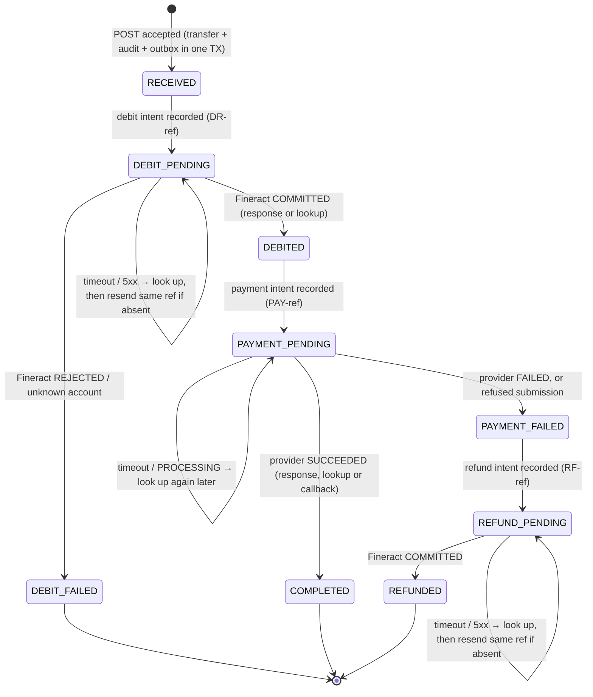

# Reliable Transfer Processing

A Spring Boot service that accepts NGN transfers from authenticated partners, debits the source account in
(mock) Fineract, pays out through a (mock) payment provider, and refunds confirmed failures. It is built so that
timeouts, crashes, broker outages, concurrent workers, redelivered messages and duplicate or conflicting callbacks
never produce a duplicate or lost financial effect.

**Stack:** Java 21, Spring Boot 4.1, PostgreSQL 17, RabbitMQ 4.1, Liquibase, Spring Security, JPA/Hibernate,
Testcontainers (with Toxiproxy).

```
Partner ──POST /api/v2/transfers──▶ API ── one DB transaction ──▶ transfers + transfer_events + outbox_messages
                                                                              │
                              Outbox relay (publisher confirms) ─────────────┘──▶ RabbitMQ: transfers.process
                                                                                         │
             Recovery poller (DB state) ──┐                                              │
                                          ▼                                              ▼
                                    TransferProcessor ◀──────────────── TransferMessageListener
                                    (lease + fencing)
                       debit  DR-<ref> ──▶ Mock Fineract   (/mock/fineract)
                       pay    PAY-<ref> ──▶ Mock provider  (/mock/provider) ──signed callbacks──┐
                       refund RF-<ref> ──▶ Mock Fineract                                         │
                                                                                                 ▼
Provider ────────────────────────────────────────────────▶ POST /api/v2/provider/events (HMAC, stored once, applied)
Operator ──GET /api/v2/ops/reconciliation──▶ transfers flagged for a human
```

---

## Contents

1. [Running it](#1-running-it)
2. [API](#2-api)
3. [Simulating failures](#3-simulating-failures)
4. [Running the tests](#4-running-the-tests)
5. [Transfer state diagram](#5-transfer-state-diagram)
6. [How it works](#6-how-it-works): transaction boundaries, concurrency, idempotency, recovery
7. [Security and authorization assumptions](#7-security-and-authorization-assumptions)
8. [If real integrations lack idempotency or reliable lookup](#8-if-real-integrations-lack-idempotency-or-reliable-lookup)
9. [Limitations and incomplete requirements](#9-limitations-and-incomplete-requirements)
10. [Configuration](#10-configuration)
11. [Code map](#11-code-map)

---

## 1. Running it

**Prerequisites:** JDK 21 or newer, and Docker (for Postgres, RabbitMQ and the tests).

```bash
# Database and broker
docker compose up -d --wait

# Service + both mocks, with demo partners, keys and funded accounts (dev profile)
./mvnw spring-boot:run -Dspring-boot.run.profiles=dev
```

| Component | Where |
|---|---|
| Service API | http://localhost:8080/api/v2 |
| Mock Fineract | http://localhost:8080/mock/fineract (in-process, own DB schema `mock_fineract`) |
| Mock payment provider | http://localhost:8080/mock/provider (in-process, own DB schema `mock_provider`) |
| PostgreSQL | `localhost:5440`, db/user/password `transfers` (5440 avoids clashing with a local Postgres) |
| RabbitMQ | `localhost:5672`; management UI http://localhost:15672 (guest/guest) |
| Health | http://localhost:8080/actuator/health |

Both mocks run inside the service process but keep their state in separate schemas and are only ever reached
over HTTP, with real client timeouts, so they behave like remote systems. Their balances, operations, payments
and pending callbacks persist across restarts.

**Demo data** (loaded only with the `dev` profile, never in tests or by default):

| Who | Credential | Authorised source account (Fineract balance) |
|---|---|---|
| Demo Merchant | `X-API-Key: dev-partner-key-001` | `1001610327` (₦1,000,000.00) |
| Other Merchant | `X-API-Key: dev-partner-key-002` | `1001610328` (₦1,000,000.00) |
| Operator | `X-Operator-Key: dev-operator-key` | n/a |

**Try it:**

```bash
curl -i -X POST localhost:8080/api/v2/transfers \
  -H 'X-API-Key: dev-partner-key-001' -H 'Content-Type: application/json' \
  -d '{"externalReference":"merchant-000001","sourceAccount":"1001610327","destinationAccount":"0123456789",
       "destinationBankCode":"000004","amount":"25000.00","currency":"NGN","narration":"Invoice payment"}'
# 202 Accepted, Location: /api/v2/transfers/TRF…   (repeat it: 200 with the same transfer)

curl localhost:8080/api/v2/transfers/<reference> -H 'X-API-Key: dev-partner-key-001'
# "state":"COMPLETED" a moment later

curl -i localhost:8080/api/v2/transfers/<reference> -H 'X-API-Key: dev-partner-key-002'
# 404: another partner's transfer is indistinguishable from a missing one
```

To reset everything: `docker compose down -v` (drops the database volume).

---

## 2. API

All errors are `application/problem+json` with a machine-readable `code`.

### `POST /api/v2/transfers`: accept a transfer (partner)

| Field | Rule |
|---|---|
| `externalReference` | 1–100 of `A–Z a–z 0–9 . _ : -`; idempotency key, scoped to the partner |
| `sourceAccount` | 10 digits; must be authorised for the calling partner |
| `destinationAccount` | 10 digits |
| `destinationBankCode` | 3–6 digits |
| `amount` | JSON string or number, parsed straight into `BigDecimal`; ≥ 0.01, at most 2 decimals |
| `currency` | `NGN` only |
| `narration` | optional, ≤ 255 chars (passed to the provider, which is how `SIM:` tokens reach the mock) |

The partner is taken from the API key, never from the body; any identifier in the body is ignored.

| Response | When |
|---|---|
| `202 Accepted` + `Location` | New transfer stored and queued for asynchronous processing |
| `200 OK` | Same partner + `externalReference` + identical payload: the existing transfer is returned |
| `409 IDEMPOTENCY_CONFLICT` | Same partner + `externalReference`, different payload |
| `403 SOURCE_ACCOUNT_NOT_PERMITTED` | Source account not authorised for this partner |
| `400 VALIDATION_FAILED` / `MALFORMED_REQUEST` | Invalid field (with per-field `errors`) / unparseable body |
| `401 UNAUTHENTICATED` | Missing, unknown or revoked key, or suspended partner |

"Identical payload" is a SHA-256 over the fields in a fixed order with the amount normalised to two decimals, so
`"25000"` and `"25000.00"` are the same request.

### `GET /api/v2/transfers/{reference}`: status (partner)

Returns the transfer if it belongs to the caller, otherwise `404 TRANSFER_NOT_FOUND`. A partner that lost the POST
response can resend the identical POST to get the reference back.

### `POST /api/v2/provider/events`: provider callbacks

Authenticated by `X-Provider-Signature: hex(HMAC-SHA256(secret, raw body))`, not by partner key. Body:
`{eventId, paymentReference, providerPaymentId, status, failureReason}`. Every stored callback gets `200` with its
`outcome` (`APPLIED`, `CONSISTENT`, `CONFLICT`, `IGNORED`, `UNMATCHED`, `DUPLICATE`), so the provider stops
redelivering. Bad or missing signature: `401`, nothing stored.

### `GET /api/v2/ops/reconciliation`: flagged transfers (operator)

Requires `X-Operator-Key`. Lists up to 100 transfers with `reconciliationRequired`, oldest first, each with the audit
events that flagged it, its financial operations and every provider callback received for it.

---

## 3. Simulating failures

### Payment provider: `SIM:` tokens in the narration

Put one or more tokens in the transfer's `narration`, e.g. `"Invoice SIM:FAIL SIM:CONFLICTING_CALLBACKS"`.

| Token | Effect |
|---|---|
| *(none)* | Payment succeeds; one callback ~0.5 s later |
| `SIM:FAIL` | Payment fails (`SIMULATED_FAILURE`); the service refunds the debit |
| `SIM:PENDING` | Stays `PROCESSING`, no callback, until resolved (below) |
| `SIM:SLOW_RESPONSE` | Payment is accepted and committed, then the response stalls past the client timeout |
| `SIM:EARLY_CALLBACK` | Callback is delivered *before* the submission response returns |
| `SIM:DUPLICATE_CALLBACKS` | Same event delivered twice, plus a second event with the same outcome |
| `SIM:DELAYED_CALLBACK` | Callback delayed (~5 s) |
| `SIM:CONFLICTING_CALLBACKS` | Outcome callback, then the *opposite* outcome later (the mock's status flips too) |
| `SIM:NO_CALLBACK` | No callback; only status lookup reveals the outcome |

Unknown tokens are rejected by the mock (`422 UNKNOWN_SCENARIO`), which the service treats as a definite payment
failure and refunds.

Settle a `SIM:PENDING` payment (optionally without a callback, so only lookup can find out):

```bash
curl -X POST localhost:8080/mock/provider/payments/PAY-<reference>/resolve \
  -H 'Content-Type: application/json' -d '{"status":"SUCCEEDED","sendCallback":false}'
```

### Fineract: commit, then time out

```bash
# The next debit or refund commits, then its response stalls 3 s (client timeout is 2 s)
curl -X POST localhost:8080/mock/fineract/faults -H 'Content-Type: application/json' -d '{"count":1,"delayMs":3000}'
curl -X DELETE localhost:8080/mock/fineract/faults
```

Insufficient funds: send more than the balance (`PUT /mock/fineract/accounts/{n}` with `{"balance":"…"}` sets it).

### RabbitMQ outage

```bash
docker compose stop rabbitmq   # POSTs still return 202; outbox rows wait with last_error set
docker compose start rabbitmq  # the relay reconnects and publishes; transfers proceed
```

### Observing what happened

| Endpoint / table | Shows |
|---|---|
| `GET /mock/fineract/stats` | `debitRequests`/`refundRequests` (API calls received) vs `committedDebits`/`committedRefunds` (financial effects) |
| `GET /mock/provider/stats` | `submissionRequests` vs accepted/succeeded/failed payments and delivered callbacks |
| `GET /mock/fineract/operations/{ref}`, `GET /mock/provider/payments/{ref}` | The mocks' authoritative record of `DR-`/`RF-`/`PAY-` operations |
| `transfer_events` | Full audit trail of each transfer |
| `financial_operations`, `provider_callbacks`, `outbox_messages` | Operation outcomes, every callback received, publication state |

The request counters are in memory and reset on restart; the committed counts come from the database.

---

## 4. Running the tests

```bash
./mvnw test   # requires Docker; about 90 seconds
```

Tests run against real PostgreSQL and RabbitMQ in Testcontainers, call the service and both mocks over HTTP, and
use the real outbox, broker, listener and recovery poller. Timeouts and leases are shortened so recovery
scenarios take seconds. The broker outage uses a Toxiproxy container between the service and RabbitMQ.

### Mandatory scenarios

| # | Scenario | Test |
|---|---|---|
| 1 | Twenty simultaneous identical requests → one transfer, one committed debit | `TransferApiTest.twentySimultaneousIdenticalRequestsCreateOneTransfer`, `DebitProcessingTest.twentySimultaneousIdenticalRequestsProduceOneDebit` |
| 2 | Two simultaneous transfers cannot overspend | `DebitProcessingTest.twoSimultaneousTransfersCannotOverspend` |
| 3 | Debit commits before a timeout; recovery confirms it without another debit | `DebitProcessingTest.debitCommittedBeforeTimeoutIsConfirmedWithoutSecondDebit` |
| 4 | Worker stops after the debit, before saving; a replacement recovers | `DebitProcessingTest.workerCrashAfterDebitIsRecoveredByReplacementWorker` |
| 5 | RabbitMQ unavailable after acceptance; processing resumes when it returns | `OutboxRelayTest.brokerOutageAfterAcceptanceLosesNothingAndProcessingResumes` |
| 6 | Callback arrives before the submission response is saved | `CallbackProcessingTest.callbackArrivingBeforeSubmissionResponseSettlesPaymentOnce` |
| 7 | Duplicate callbacks and redelivered messages create no extra debits, payments or refunds | `CallbackProcessingTest.duplicateCallbacksCreateNoAdditionalEffects`, `DebitProcessingTest.redeliveredMessagesCreateNoAdditionalEffects` |
| 8 | Provider timeout leaves the payment unresolved until authoritative evidence | `PaymentProcessingTest.providerTimeoutLeavesPaymentUnresolvedUntilEvidence` |
| 9 | A confirmed failure produces one refund despite concurrent recovery workers | `RefundProcessingTest.confirmedFailureProducesOneRefundDespiteConcurrentRecoveryWorkers` |
| 10 | Success callback after a completed refund preserves both facts and flags the conflict | `RefundProcessingTest.successCallbackAfterCompletedRefundPreservesBothFactsAndFlagsConflict` |

Each test distinguishes repeated **calls** from repeated **effects**: it asserts on the mocks' committed operations
(from their tables) and, where it matters, on their request counters. Scenario 3, for example, proves exactly one
debit call was made and the outcome was then learned by lookup (`DEBIT_CONFIRMED` has `"source": "lookup"`).

**Worker crashes** (scenarios 4 and 9) are simulated with `ProcessingCheckpoints`, a hook the worker calls at named
points such as `AFTER_DEBIT_CALL`. In production it does nothing; a test replaces it with a mock that throws once.
The throw propagates exactly like a crash: the lease is *not* released and nothing after that point is saved.

Other suites cover the mocks themselves (`MockFineractTest`, `MockProviderTest`), authentication and authorization
(`SecurityTest`, `ReconciliationApiTest`), validation and idempotency edge cases (`TransferApiTest`), and further
payment, callback and refund paths.

---

## 5. Transfer state diagram



`DEBIT_FAILED`, `COMPLETED` and `REFUNDED` are terminal. Orthogonal to the state, `reconciliationRequired` is set
when facts conflict or automation must stop:

| Trigger | State kept | Automatic processing |
|---|---|---|
| FAILED callback after `COMPLETED` | `COMPLETED` | Nothing pending |
| SUCCEEDED callback after `REFUNDED` / during `REFUND_PENDING` | unchanged | Refund already done / continues |
| SUCCEEDED callback while `PAYMENT_FAILED` (refund not started) | `PAYMENT_FAILED` | **Refund held**: refunding could pay out twice |
| Fineract refuses a refund, or a reference is bound to a different request (409) | unchanged | Stopped |

---

## 6. How it works

### 6.1 Transaction boundaries

**No external call is ever made inside a database transaction.** Each step is *record intent → call → record
outcome*, with each record its own short transaction.

| Transaction | Contents |
|---|---|
| Accept (`TransferCreator`) | Insert transfer (`RECEIVED`) + `TRANSFER_ACCEPTED` audit event + outbox row. All or nothing. |
| Outbox relay batch (`OutboxRelay`) | Lock due rows (`FOR UPDATE SKIP LOCKED`), publish, await confirms, mark published or failed. |
| Claim / release lease | Single conditional `UPDATE`s. |
| Each transition (`TransferTransitions`) | Verify lease + expected state, update transfer and `financial_operations`, append audit event. |
| Callback (`ProviderCallbackService`) | Insert callback (dedupe by event id) + lock transfer row + apply or flag + audit event. |

Because intent is committed before each call, a crash at any point leaves a durable `*_PENDING` state that says
exactly which external operation might have happened, and under which reference.

### 6.2 Idempotency

| Boundary | Mechanism |
|---|---|
| Partner → service | `UNIQUE (partner_id, external_reference)` + stored `request_hash`. The insert races are decided by the database: losers catch the violation and re-read the winner **in a fresh transaction** (Postgres aborts a transaction after a constraint error), returning `200` or `409`. |
| Service → Fineract / provider | Deterministic operation references derived from the transfer: `DR-<ref>`, `PAY-<ref>`, `RF-<ref>`. Every retry reuses the same reference; the mocks return the stored result for an identical repeat and reject a conflicting one. |
| One effect per kind | `UNIQUE (transfer_id, operation_type)` on `financial_operations`: at most one debit, payment and refund row per transfer. Mock Fineract additionally allows only one refund per debit. |
| RabbitMQ → worker | The message only names the transfer; the database state decides the next step. Duplicates and redeliveries find nothing to do. |
| Provider → service | `provider_callbacks.provider_event_id UNIQUE`; `INSERT … ON CONFLICT DO NOTHING`. A concurrent duplicate waits on the index, then inserts nothing. |

### 6.3 Concurrency controls

- **Processing lease.** A worker claims a transfer with
  `UPDATE transfers SET lease_owner = :token, lease_expires_at = now() + 30s, version = version + 1
  WHERE id = :id AND state IN (non-terminal) AND (lease_owner IS NULL OR lease_expires_at < now())`.
  Zero rows means someone else has it. The token is unique per processing attempt, so even two threads in one
  instance are distinct.
- **Fencing.** Every transition re-reads the transfer, checks `lease_owner = me` and the expected state, and relies
  on JPA `@Version`: if another worker claimed the lease (bumping the version) after the check, the commit fails
  and the stale worker stops without writing.
- **Callbacks vs workers.** The callback handler takes a `SELECT … FOR UPDATE` row lock instead of the lease. Its
  version bump means a worker about to save a late response fails its write: whichever lands first wins, and the
  other observes the settled state (`expected PAYMENT_PENDING but was COMPLETED` in the logs).
- **Funds.** The available-balance check is Fineract's: a single `UPDATE accounts SET balance = balance - x WHERE
  balance >= x` serialised by the row lock. The service never pre-checks balances.
- **Outbox.** `FOR UPDATE SKIP LOCKED` lets several relay instances drain the outbox without double-publishing.

### 6.4 Asynchronous processing and the outbox

The API never talks to RabbitMQ. The outbox row commits with the transfer, and `OutboxRelay` publishes it with
**publisher confirms** and **mandatory routing**: a row counts as published only when the broker has confirmed it
and routed it to a queue. Otherwise the error is recorded and the row is retried with exponential backoff (capped
at 30 s). Delivery is therefore at least once (a crash between confirm and commit republishes), which the worker
tolerates by design. A message that throws is dead-lettered (`transfers.process.dlq`) rather than redelivered in a
hot loop; the transfer itself is still recovered from database state.

### 6.5 Recovery

- **Every non-terminal state carries a `next_attempt_at`.** Before an external call it is set to "after the lease
  ends"; after an unresolved call, to a backoff time.
- **`TransferRecovery`** polls every second for transfers in an actionable state whose `next_attempt_at` has passed
  and whose lease is free or expired, and processes them. It runs on every instance; the lease makes that safe.
  Accepted transfers get a 30 s grace period for their message before recovery picks them up.
- **Resumed operations are looked up before anything is resent.** For `DEBIT_PENDING`, `PAYMENT_PENDING` and
  `REFUND_PENDING`, the worker first asks the external system for the operation by its reference. Found: apply that
  outcome. Not found: the operation never happened, so it is sent again under the same reference.
- **A crash is not cleaned up.** Unexpected exceptions leave the lease in place, exactly as a dead process would;
  the lease expires and recovery resumes from the last committed state.
- **Timeouts are never failures.** A payment whose submission timed out, or that the provider reports as
  `PROCESSING`, stays `PAYMENT_PENDING` and is polled with backoff until the provider answers `SUCCEEDED` or
  `FAILED` (by response, lookup or callback). No refund happens without that evidence.

### 6.6 Callbacks never overwrite outcomes

| Recorded state | Callback `SUCCEEDED` | Callback `FAILED` |
|---|---|---|
| `PAYMENT_PENDING` | → `COMPLETED` (`APPLIED`) | → `PAYMENT_FAILED`, refund due (`APPLIED`) |
| `COMPLETED` | `CONSISTENT` | `CONFLICT`: flagged, state kept |
| `PAYMENT_FAILED` / `REFUND_PENDING` / `REFUNDED` | `CONFLICT`: flagged (refund held if not started) | `CONSISTENT` |

Non-final statuses are `IGNORED`; unknown references are stored as `UNMATCHED`. Every callback is kept verbatim
(`payload` is the raw body), so for scenario 10 both facts survive: the committed refund and the provider's later
success claim, linked by a `CALLBACK_CONFLICT` audit event.

### 6.7 Audit history

`transfer_events` is append-only (`@Immutable`). Each row records the event type, from/to state, actor (`partner:<id>`,
`worker-…/<token>`, `provider-callback:<eventId>`) and JSON detail: operation references, Fineract transaction ids,
provider payment ids, whether an outcome came from a `response`, `lookup` or `callback`, and errors from unresolved
attempts. Together with `financial_operations`, `provider_callbacks` and `outbox_messages`, every financial operation
and state transition can be reconstructed.

---

## 7. Security and authorization assumptions

- **Partner authentication:** `X-API-Key`, stored only as SHA-256 hashes. Revoked keys and non-`ACTIVE` partners
  are rejected. Keys are long random secrets issued out of band, so a fast hash (rather than a password hash) is
  appropriate. There is no key-management API; keys are inserted directly (see `008-dev-seed.sql`).
- **Partner identity comes only from the key.** Identifiers in request bodies are ignored.
- **Authorization:** a partner may debit only source accounts listed for it in `partner_accounts` (`403`), and may
  read only its own transfers (`404` otherwise, so existence is not revealed). Idempotency is scoped per partner.
- **Provider callbacks:** HMAC-SHA256 over the raw body with a shared secret (`PROVIDER_CALLBACK_SECRET`), compared
  in constant time. Replay of an old event is harmless (deduplicated by event id); there is no timestamp window
  because the mock does not send one.
- **Operators:** `X-Operator-Key` checked against `OPS_OPERATOR_KEY_SHA256`. With no hash configured, operator access
  is disabled. Operator and partner roles are disjoint.
- **Transport:** TLS is assumed to be terminated in front of the service.
- **Mocks are unauthenticated** and exposed at `/mock/**`. They stand in for external systems and must not be
  deployed with the service (see limitations).
- The API is stateless: no sessions or cookies, so CSRF protection is disabled. All secrets in `application.properties`
  and `application-dev.properties` are local-development defaults, overridable by environment variables.

---

## 8. If real integrations lack idempotency or reliable lookup

The design leans on two capabilities the exercise lets the mocks provide. Real Fineract deployments and providers
may offer neither. This is what changes.

| Capability missing | What breaks | What the service would have to do |
|---|---|---|
| **Fineract: no idempotent operation reference** | Resending a debit or refund after a timeout could move money twice. | Never resend after an unknown outcome. Resolve only by lookup; if lookup is not possible either, flag for reconciliation. The guarantee weakens from "exactly once, automatically" to "at most once automatically, otherwise human". |
| **Fineract: no lookup by reference** | `DEBIT_PENDING` / `REFUND_PENDING` cannot be resolved after a timeout or crash. | If submission *is* idempotent, resending the same reference is the lookup (the replay returns the stored result). If neither exists, unknown outcomes go to reconciliation against Fineract statements, and refunds of an unknown debit must wait for it. |
| **Fineract: no atomic funds check** | Concurrent debits (ours or other channels') could overdraw. | The service cannot fix this alone. It could serialise its own debits per source account (e.g. advisory locks), but other channels would still race. |
| **Provider: no idempotent submission** | Resubmitting after a timeout could pay twice. | Never resubmit once a submission may have reached the provider; rely on lookup and callbacks only. |
| **Provider: no status lookup** | A timed-out payment can only be settled by a callback. | Callbacks become the only evidence; payments stay `PAYMENT_PENDING` until one arrives. An age threshold must flag long-pending payments for reconciliation against settlement reports. No automatic refund without a confirmed failure. |
| **Provider: callbacks without stable event ids** | Exact duplicates can't be detected by id. | Deduplicate on `(paymentReference, status)` instead. Harmless here, because applying the same outcome twice is already a no-op. |
| **Provider: unsigned callbacks** | Anyone could forge an outcome. | Use mTLS or an IP allowlist, and treat callbacks as hints: confirm each by lookup before applying it. |

The constant is the rule that **an unknown outcome is never treated as success or failure**. When the system can
neither ask nor safely retry, it stops and tells a human rather than guessing.

---

## 9. Limitations and incomplete requirements

All mandatory endpoints, requirements and test scenarios are implemented. Known limitations:

- **Mocks are in-process** and always enabled. In a real deployment they would be separate services, or at least
  disabled by profile; `/mock/**` is unauthenticated.
- **Reconciliation is read-only.** Flagged transfers are listed with their evidence, but there is no workflow to
  resolve them (choose a fact, post a correcting entry, clear the flag).
- **Unresolved operations are retried indefinitely** with capped backoff (30 s). There is no age-based alerting or
  automatic flag for, say, a payment pending for days.
- **No lease renewal.** The lease (30 s) is far longer than client timeouts (2 s), so a call cannot outlive it; if
  one did, fencing would still stop the stale worker from writing.
- **Housekeeping:** published outbox rows, the dead-letter queue and old callbacks are never purged.
- **Mock request counters** (`debitRequests`, `submissionRequests`, …) and Fineract fault injection are in memory and
  reset on restart; committed outcomes are durable.
- **Scope as specified:** NGN principal only, no fees or taxes, full refunds only. No rate limiting.
- One run of `TransferApiTest` in isolation once errored on every test, consistent with a container start-up
  failure; it did not recur across many subsequent full runs.

---

## 10. Configuration

Defaults are in `src/main/resources/application.properties`; the dev profile adds `application-dev.properties`.

| Property / env var | Default | Meaning |
|---|---|---|
| `DB_URL`, `DB_USERNAME`, `DB_PASSWORD` | compose values | PostgreSQL |
| `RABBITMQ_HOST`, `RABBITMQ_PORT`, `RABBITMQ_USERNAME`, `RABBITMQ_PASSWORD` | `localhost:5672`, guest | RabbitMQ |
| `PROVIDER_CALLBACK_SECRET` | `dev-callback-secret` | HMAC secret for callbacks |
| `OPS_OPERATOR_KEY_SHA256` | empty (operators disabled) | SHA-256 of the operator key |
| `fineract.base-url`, `provider.base-url` | the in-process mocks | External systems |
| `fineract.read-timeout-ms`, `provider.read-timeout-ms` | `2000` | Client timeouts |
| `worker.lease-seconds` | `30` | Processing lease |
| `worker.concurrency` | `4` | Listener threads |
| `worker.recovery.grace-ms` / `poll-ms` | `30000` / `1000` | Message grace period / recovery poll interval |
| `worker.retry.initial-ms` / `max-ms` | `500` / `30000` | Backoff for unresolved calls |
| `outbox.relay.*` | 200 ms poll, batch 50, 5 s confirm timeout, 30 s max backoff | Outbox relay |
| `mock.provider.*` | 0.5 s callback, 5 s delayed callback, 5 s slow response | Mock provider timings |

The database schema is owned by Liquibase (`src/main/resources/db/changelog`); Hibernate only validates it.

---

## 11. Code map

```
src/main/java/com/transferservice/transfer_processing_service/
├── transfer/          Transfer, TransferState, FinancialOperation, TransferEvent, repositories,
│   │                  TransferService (idempotent initiation), TransferCreator (accept transaction)
│   └── api/           TransferController, request/response types, error mapping
├── outbox/            OutboxMessage, OutboxRelay (confirms, SKIP LOCKED, backoff)
├── messaging/         RabbitMQ topology (exchange, queue, dead-letter queue)
├── worker/            TransferProcessor (lease, steps), TransferTransitions (fenced state changes),
│                      TransferMessageListener, TransferRecovery, RetryPolicy, ProcessingCheckpoints
├── callback/          ProviderCallbackController (HMAC), ProviderCallbackService (dedupe, apply, conflicts)
├── reconciliation/    Operator view of flagged transfers
├── integration/       FineractClient, ProviderClient (classify: definite rejection vs unknown outcome)
├── partner/           Partner authentication and source-account authorization
├── security/          Spring Security: API key and operator key filters, problem+json 401/403
├── mock/fineract/     Mock Fineract (atomic debits, idempotent references, lookup, faults, stats)
├── mock/provider/     Mock payment provider (SIM: scenarios, persisted signed callbacks, stats)
└── common/            Hashing, scheduling
src/main/resources/db/changelog/   Liquibase migrations (service and mock schemas, dev seed)
src/test/java/…                    Integration tests (see section 4)
```
