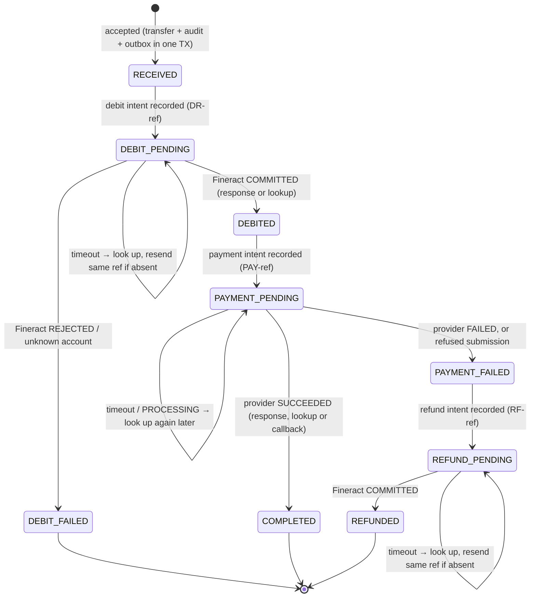

# Reliable Transfer Processing

A Spring Boot service that accepts NGN transfers from authenticated partners, debits the source account in a mock
Fineract, pays out through a mock payment provider, and refunds confirmed failures, without duplicate or lost
financial effects under timeouts, crashes, broker outages, concurrent workers and duplicate or conflicting callbacks
(given the integration capabilities in [section 7](#7-if-real-integrations-lack-idempotency-or-reliable-lookup)).

**Stack:** Java 21, Spring Boot 4.1, PostgreSQL 17, RabbitMQ 4.1, Liquibase, Spring Security, JPA, Testcontainers.

## 1. Running it

Requires JDK 21+ and Docker.

```bash
docker compose up -d --wait                          # PostgreSQL (localhost:5440) and RabbitMQ (5672, UI on 15672)
./mvnw spring-boot:run -Dspring-boot.run.profiles=dev
```

This starts the service on http://localhost:8080 together with both mocks (`/mock/fineract`, `/mock/provider`). The
mocks run in the same process but keep their state in their own database schemas and are only reached over HTTP with
real client timeouts. The `dev` profile seeds demo data:

| Credential | Use |
|---|---|
| `X-API-Key: dev-partner-key-001` | Demo Merchant; may debit `1001610327` (₦1,000,000 in Fineract) |
| `X-API-Key: dev-partner-key-002` | Other Merchant; may debit `1001610328` |
| `X-Operator-Key: dev-operator-key` | Operator endpoint |

```bash
curl -i -X POST localhost:8080/api/v2/transfers \
  -H 'X-API-Key: dev-partner-key-001' -H 'Content-Type: application/json' \
  -d '{"externalReference":"merchant-000001","sourceAccount":"1001610327","destinationAccount":"0123456789",
       "destinationBankCode":"000004","amount":"25000.00","currency":"NGN","narration":"Invoice payment"}'
curl localhost:8080/api/v2/transfers/<reference> -H 'X-API-Key: dev-partner-key-001'   # COMPLETED shortly after
```

| Endpoint | Responses |
|---|---|
| `POST /api/v2/transfers` | `202` accepted · `200` identical repeat · `409` same `externalReference`, different payload · `403` source account not authorised · `400` invalid · `401` no/bad key |
| `GET /api/v2/transfers/{reference}` | `200` · `404` unknown or another partner's (the reference is the service's `TRF…` id from the POST) |
| `POST /api/v2/provider/events` | `200` with the callback's outcome · `401` bad `X-Provider-Signature` (HMAC-SHA256 of the body) |
| `GET /api/v2/ops/reconciliation` | Transfers flagged for reconciliation, with their evidence (operator key) |

Errors from these endpoints are `application/problem+json` with a `code`. `docker compose down -v` resets all data.

## 2. Running tests and simulating failures

```bash
./mvnw test   # requires Docker; about 90 seconds
```

Tests use real PostgreSQL and RabbitMQ (Testcontainers) and drive the service and mocks over HTTP. Worker crashes are
simulated by `ProcessingCheckpoints`, a hook that does nothing in production and that a test makes throw once at a
named point. The lease is then not released and nothing after that point is saved, exactly as if the process died.

| # | Mandatory scenario | Test |
|---|---|---|
| 1 | 20 simultaneous identical requests → one transfer, one debit | `TransferApiTest`, `DebitProcessingTest.twentySimultaneousIdenticalRequestsProduceOneDebit` |
| 2 | Two transfers cannot overspend | `DebitProcessingTest.twoSimultaneousTransfersCannotOverspend` |
| 3 | Debit commits, response times out; recovery confirms without a second debit | `DebitProcessingTest.debitCommittedBeforeTimeoutIsConfirmedWithoutSecondDebit` |
| 4 | Worker stops after the debit; a replacement recovers | `DebitProcessingTest.workerCrashAfterDebitIsRecoveredByReplacementWorker` |
| 5 | RabbitMQ down after acceptance; processing resumes | `OutboxRelayTest.brokerOutageAfterAcceptanceLosesNothingAndProcessingResumes` (Toxiproxy) |
| 6 | Callback before the submission response is saved | `CallbackProcessingTest.callbackArrivingBeforeSubmissionResponseSettlesPaymentOnce` |
| 7 | Duplicate callbacks and redeliveries: no extra debits, payments or refunds | `CallbackProcessingTest.duplicateCallbacksCreateNoAdditionalEffects`, `DebitProcessingTest.redeliveredMessagesCreateNoAdditionalEffects`, `RefundProcessingTest.duplicateCallbacksAndRedeliveredMessagesCreateNoAdditionalRefunds` |
| 8 | Provider timeout stays unresolved until authoritative evidence | `PaymentProcessingTest.providerTimeoutLeavesPaymentUnresolvedUntilEvidence` |
| 9 | One refund despite concurrent recovery workers | `RefundProcessingTest.confirmedFailureProducesOneRefundDespiteConcurrentRecoveryWorkers` |
| 10 | Success callback after a refund keeps both facts and flags the conflict | `RefundProcessingTest.successCallbackAfterCompletedRefundPreservesBothFactsAndFlagsConflict` |

Tests assert on the mocks' committed operations, not just on API calls. `GET /mock/fineract/stats` and
`GET /mock/provider/stats` expose both: request counts (in memory) and committed outcomes (from the database).

**Triggering failures by hand.** Put tokens in the transfer's `narration` to steer the mock provider:

| Token | Effect |
|---|---|
| `SIM:FAIL` | Payment fails; the service refunds the debit |
| `SIM:PENDING` | Stays `PROCESSING` until `POST /mock/provider/payments/PAY-<reference>/resolve` with `{"status":"SUCCEEDED"\|"FAILED","sendCallback":false}` |
| `SIM:SLOW_RESPONSE` | Payment accepted, then the response stalls past the client timeout |
| `SIM:EARLY_CALLBACK` | Callback delivered before the submission response returns |
| `SIM:DUPLICATE_CALLBACKS` / `SIM:DELAYED_CALLBACK` / `SIM:NO_CALLBACK` | Same event twice plus a repeat event / callback after ~5 s / none |
| `SIM:CONFLICTING_CALLBACKS` | Outcome, then the opposite outcome ~5 s later |

```bash
# Fineract: the next debit or refund commits, then its response stalls past the 2 s client timeout
curl -X POST localhost:8080/mock/fineract/faults -H 'Content-Type: application/json' -d '{"count":1,"delayMs":3000}'
# RabbitMQ outage: POSTs still return 202; processing resumes after the restart
docker compose stop rabbitmq && sleep 10 && docker compose start rabbitmq
```

## 3. Transfer states



Separately from the state, `reconciliationRequired` is set when facts conflict or automation must stop: a
contradicting callback, a refused refund, or a 409 reference conflict. A flagged transfer is never moved on
automatically, not even by a redelivered message. The one exception is a refund already under way, which is
finished. If a success claim arrives before a refund starts, the refund is held, because refunding could pay out twice.

## 4. How it works

**Transaction boundaries.** No external call happens inside a database transaction. Each step is *record intent →
call → record outcome*, each record its own short transaction with an audit event. Acceptance writes the transfer, its
first audit event and an outbox row in one transaction. A crash at any point therefore leaves a `*_PENDING` state that
names exactly which operation might have happened, and under which reference.

**Idempotency.**
- **Partner requests:** `UNIQUE (partner_id, external_reference)` plus a stored SHA-256 of the request (amount
  normalised to 2 dp). Concurrent duplicates are decided by the database; losers re-read the winner in a fresh
  transaction and return `200` or `409`.
- **Outbound calls:** deterministic operation references (`DR-`/`PAY-`/`RF-<reference>`), reused on every retry, plus
  `UNIQUE (transfer_id, operation_type)`, so there is at most one debit, payment and refund per transfer. Mock
  Fineract also allows only one refund per debit.
- **Messages:** a message only names the transfer, and the database state decides the next step.
- **Callbacks:** `provider_event_id UNIQUE` with `INSERT … ON CONFLICT DO NOTHING`.

**Concurrency controls.**
- **Lease:** a worker claims a transfer with a conditional `UPDATE` that succeeds only if the lease is free or
  expired, and bumps `@Version`. The owner token is unique per processing attempt.
- **Fencing:** every transition checks lease owner and expected state, and the version check fails the commit if
  another worker took over in between.
- **Callbacks** take a row lock instead (JPA `PESSIMISTIC_WRITE`, issued on PostgreSQL as `FOR NO KEY UPDATE`) and
  bump the version, so whichever of callback or late worker response lands first wins and the other changes nothing.
- **Funds:** Fineract checks funds with a single `UPDATE … WHERE balance >= amount`.
- **Outbox:** relay instances share the outbox with `FOR UPDATE SKIP LOCKED`.

**Asynchronous processing.** A relay publishes outbox rows with publisher confirms and mandatory routing, marks them
published only when confirmed and routed, and otherwise retries with backoff (capped at 30 s). So a broker outage
delays work but never loses it. Delivery is at least once, which the worker tolerates. Failing messages are
dead-lettered rather than redelivered in a loop.

**Recovery.** Every non-terminal, unflagged transfer carries a `next_attempt_at`: "after the lease ends" while a call
is in flight, a backoff time after an unresolved call. A poller on every instance resumes due transfers whose lease is
free or expired, including accepted transfers whose message never arrived (after a 30 s grace period). Resumed
operations are **looked up by reference before anything is resent**. Timeouts are never treated as failures: a payment
stays `PAYMENT_PENDING` until the provider answers `SUCCEEDED` or `FAILED` by response, lookup or callback, and no
refund happens without that evidence.

**Callbacks** settle a pending payment but never overwrite a recorded outcome. A contradicting callback is stored
(full payload, as JSONB), audited as `CALLBACK_CONFLICT` and flags the transfer, so for scenario 10 both the refund and
the later success claim survive.

**Audit.** `transfer_events` is append-only by construction (insert-only, Hibernate `@Immutable`). Each row has the
from/to state, the actor (partner, worker attempt or callback event) and details such as operation references,
external transaction ids and whether an outcome came from a response, a lookup or a callback.

## 5. Security and authorization assumptions

- Partners authenticate with `X-API-Key`. Keys are stored only as SHA-256 hashes. Revoked keys and non-active partners
  are rejected. Keys are issued out of band; there is no key-management API. Partner identity never comes from the
  request body.
- A partner may debit only source accounts listed for it in `partner_accounts`, and read only its own transfers.
  Idempotency is scoped per partner.
- Provider callbacks are verified by HMAC-SHA256 over the raw body (constant-time comparison). Replays are
  deduplicated by event id; there is no timestamp window.
- The operator endpoint uses `X-Operator-Key`, checked against `OPS_OPERATOR_KEY_SHA256`. It is disabled when that
  hash is unset. Operator and partner roles are disjoint.
- TLS is assumed to terminate in front of the service. The API is stateless (no sessions, so no CSRF).
- Defaults in `application.properties` are for local use and read environment variables (`DB_PASSWORD`,
  `RABBITMQ_PASSWORD`, `PROVIDER_CALLBACK_SECRET`, `OPS_OPERATOR_KEY_SHA256`). The dev keys exist only in the `dev`
  profile.

## 6. Incomplete requirements and limitations

All required endpoints, behaviours and test scenarios are implemented. Limitations:

- The mocks run in-process and `/mock/**` is unauthenticated. In a real deployment they would be separate or disabled.
- Reconciliation is read-only: flagged transfers are listed with their evidence, but resolving them is manual.
- Unresolved operations are retried indefinitely (capped backoff), with no age-based alerting.
- Concurrency across instances relies on database-level leases and constraints. Tests exercise it with concurrent
  workers in one process (each with its own lease token), not with separate processes.
- Published outbox rows, dead-lettered messages and old callbacks are never purged.
- Mock request counters and Fineract fault settings are in memory and reset on restart. Committed outcomes persist.
- NGN principal only, full refunds only, no rate limiting.

## 7. If real integrations lack idempotency or reliable lookup

| Missing | Risk | What would have to change |
|---|---|---|
| Fineract idempotent references | Resending after a timeout could move money twice | Never resend after an unknown outcome; resolve by lookup only, else flag for reconciliation. "Exactly once, automatically" becomes "at most once automatically, otherwise a human". |
| Fineract lookup | Pending debits and refunds cannot be resolved | If submission is idempotent, resending the same reference is the lookup. If neither is available, reconcile against statements, and hold refunds until the debit is known. |
| Fineract atomic funds check | Overdrafts from concurrent debits | Cannot be fixed by this service alone. It can serialise its own debits per account, not other channels'. |
| Provider idempotent submission | Resubmitting could pay twice | Never resubmit once a submission may have arrived; rely on lookup and callbacks. |
| Provider status lookup | Timed-out payments can only be settled by callbacks | Payments wait in `PAYMENT_PENDING`; an age threshold flags them for reconciliation against settlement reports. Still no refund without a confirmed failure. |
| Callback event ids or signatures | Duplicates or forgeries cannot be detected | Deduplicate on reference and status (harmless, since reapplying an outcome is a no-op). Authenticate with mTLS or an IP allowlist, and confirm each callback by lookup. |

The rule throughout: **an unknown outcome is never treated as success or failure**. When the service can neither ask
nor retry safely, it stops and flags the transfer for a human.
